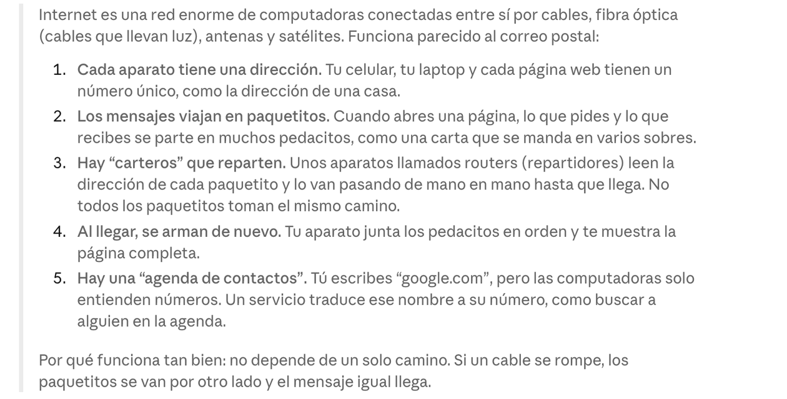

<div align="center">

# En corto

**La idea central de cada explicación larga de Claude, en una sola línea.**

Un mod para Claude Code que lee las respuestas largas por ti y te deja un resumen en un recuadro, debajo de la respuesta y justo arriba del cuadro donde escribes.


</div>

---

## Así se ve

Claude responde algo largo…



…y En corto te deja la idea central:


## Por qué

Leer respuestas largas cansa, sobre todo cuando estás haciendo varias cosas a la vez o te cuesta mantener la atención en bloques de texto. En corto te dice de qué trató la respuesta en segundos; si quieres los detalles, siguen ahí arriba.

## Instalación

En la terminal, dentro de Claude Code:

```
/plugin install en-corto --marketplace gereyes/en-corto
```

Responde `y` para agregar el marketplace y elige el alcance con Enter. El mod queda activo de inmediato.

Desde la línea de comandos:

```
claude plugin install en-corto --marketplace gereyes/en-corto
```

En la app de escritorio, en la pestaña **Code**: haz clic en **+** junto al cuadro de texto, luego **Plugins**, **Add marketplace** con `gereyes/en-corto` y después **Add plugin**.

## Ejemplos

| Le preguntas a Claude | Qué muestra En corto |
|---|---|
| ¿Cómo funciona internet? | Internet envía la información en paquetitos con direcciones, que los routers reparten por distintos caminos hasta llegar a su destino. |
| ¿Cuál es la historia de la humanidad? | La humanidad pasó de cazar y recolectar a la agricultura, las ciudades, los imperios, la industria y hoy la era digital. |
| Arregla este error y dime qué pasó | Nada: es un reporte de avance, no una explicación, así que no aparece recuadro. |
| ¿Qué hora es en Japón? | Nada: la respuesta es corta y se lee de un vistazo. |

## Cómo funciona

- Cuando una respuesta pasa de 120 palabras (sin contar bloques de código ni tablas, que ya se leen de un vistazo), el mod se la pasa a Haiku, el modelo más barato de Claude.
- Si la respuesta explica algo, Haiku escribe su idea central en una línea, aunque la respuesta termine con una pregunta. Si solo reporta avance o confirma algo hecho, no se muestra nada.
- El recuadro se reemplaza con cada respuesta nueva y desaparece cuando mandas tu siguiente mensaje.
- Las respuestas de los subagentes se ignoran.
- El resumen sale en el idioma de la respuesta.

## Comando

- `/en-corto`: prende o apaga el mod. La preferencia se guarda entre sesiones.

## Qué datos envía

- El texto completo de cada respuesta larga se envía a Haiku **con tu misma cuenta y tu mismo proveedor de Claude Code**, igual que cualquier otra llamada de tu sesión. No pasa por ningún servidor de terceros.
- El mod no guarda las respuestas ni los resúmenes en disco. Lo único que guarda es si lo tienes prendido o apagado.
- Donde el recuadro no se puede dibujar (`claude -p`, el SDK o VS Code), el mod no llama a Haiku.

## Costo

Cada resumen es una llamada pequeña a Haiku (esfuerzo bajo, máximo 120 tokens de salida), solo para las respuestas largas. Se cobra a la misma cuenta que usa tu sesión de Claude Code.

## Solución de problemas

- **No aparece el recuadro.** Revisa que estés en la terminal o en la pestaña **Code** de la app de escritorio; la pestaña Chat no carga mods. Si la sesión ya estaba abierta cuando lo instalaste, abre una nueva. Revisa también que no lo hayas apagado con `/en-corto`.
- **Aparece y desaparece sin resumen.** Tu cuenta o tu organización puede no tener permiso para usar Haiku. En ese caso el mod no muestra nada y tu sesión sigue funcionando normal.
- **Sale con respuestas que no lo necesitan, o no sale cuando debería.** Quien decide es Haiku a partir del contenido; si ves un caso raro, abre un issue con la respuesta de ejemplo.

## Requisitos

Claude Code 2.1.287 o más nuevo en la terminal, o 2.1.286 o más nuevo en la pestaña Code de la app de escritorio.

## Licencia

[MIT](LICENSE)

---

<sub>**English:** En corto ("in short") is a Claude Code mod that summarizes each long explanation from Claude into one line, shown in a box right above the prompt. It uses Haiku with your own session's credentials, skips short answers, progress reports and subagents, and can be toggled with `/en-corto`.</sub>
